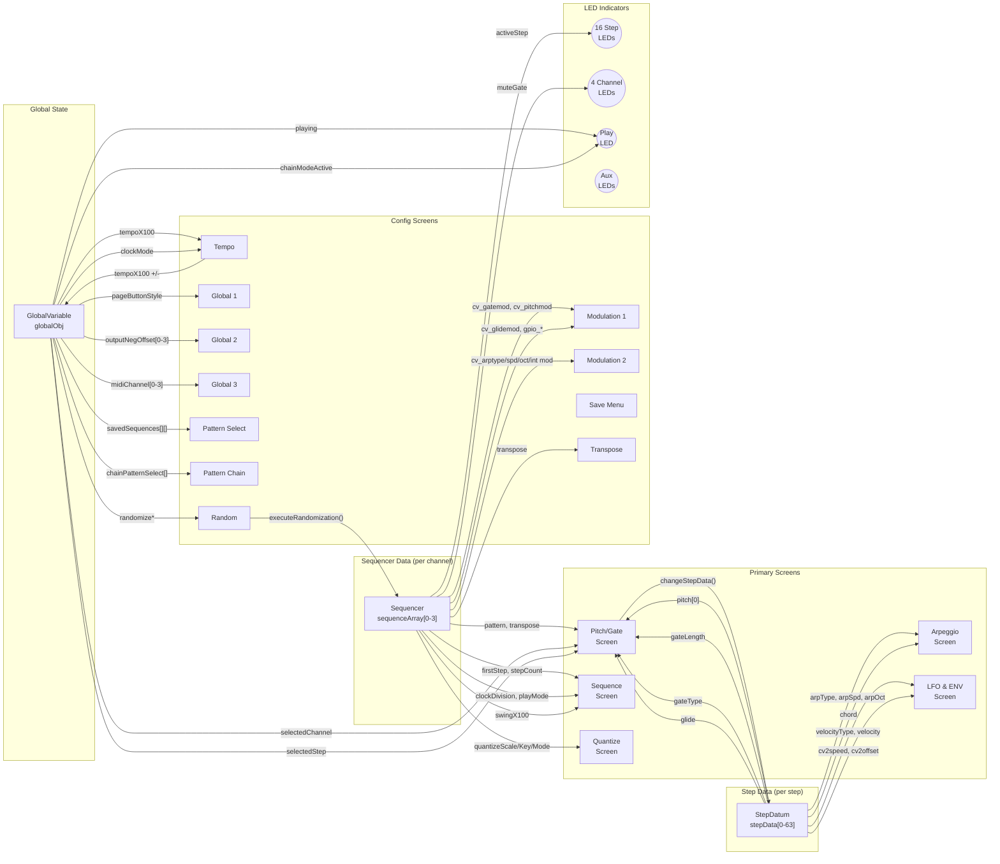
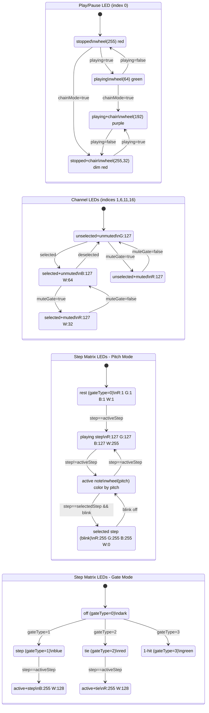

# FLXS1 UI Interaction Diagrams

Generated from `spec/ui/` specs via `/fw-ui-diagram`.

---

## 1. Navigation Flow

```mermaid
stateDiagram-v2
    [*] --> PITCH_GATE

    state "Step Editing" as step_edit {
        state "PITCH / GATE\npitch, gate len, gate type, glide" as PITCH_GATE
        state "ARPEGGIO\nalgo, speed, octave, interval" as ARPEGGIO
        state "LFO & ENV\ntype, amplitude, speed, offset" as VELOCITY
    }

    state "Channel Settings" as ch_settings {
        state "SEQUENCE\nfirst step, count, clk div, dir, swing" as SEQUENCE
        state "QUANTIZE\nscale, key, mode" as QUANTIZE
        state "MODULATION 1\nskip, gate, random, pitch, glide CV" as MOD1
        state "MODULATION 2\narp type/speed/oct/interval CV" as MOD2
    }

    state "Global / System" as global_sys {
        state "GLOBAL 1\npg btn style, data knob style" as GLOBAL1
        state "GLOBAL 2\npitch CV voltage ranges" as GLOBAL2
        state "GLOBAL 3\nMIDI output channels" as GLOBAL3
        state "SYSEX\nimport / export" as SYSEX
        state "SYSEX IMPORT\nimport progress" as SYSEX_IMP
    }

    state "Pattern Management" as pattern_mgmt {
        state "PATTERN SELECT\n4x4 grid, 8 pages" as PATTERN
        state "SAVE\nchannel select, destination" as SAVE
        state "PATTERN CHAIN\nsong editor, chain entries" as CHAIN
    }

    state "Shortcuts (CH hold + matrix)" as shortcuts {
        state "RANDOM\nparam, min, max, type" as RANDOM
        state "TRANSPOSE\nscale degrees +/-" as TRANSPOSE
        state "FILL" as FILL
        state "SKIP\ncount, trigger" as SKIP
        state "CLK DIV" as CLKDIV
        state "TUNER" as TUNER
        state "PAGE" as PAGE
        state "FN 1-4" as FN
    }

    state "Diagnostics" as diag {
        state "TEMPO\nBPM, sync source, reset" as TEMPO
        state "CALIBRATION\nADC/DAC cal, MIDI/gate/rheo test" as CALIB
        state "INPUT DEBUG\nraw ADC, gate inputs" as DEBUG
    }

    %% Channel button cycling (same channel)
    PITCH_GATE --> SEQUENCE : ch btn (same)
    SEQUENCE --> QUANTIZE : ch btn (same)
    QUANTIZE --> MOD1 : ch btn (same)
    MOD1 --> MOD2 : ch btn (same)
    MOD2 --> PITCH_GATE : ch btn (same)

    %% Pattern button
    PITCH_GATE --> PATTERN : PATTERN btn
    PATTERN --> PITCH_GATE : PATTERN btn

    %% Save
    PITCH_GATE --> SAVE : SHIFT+PATTERN
    SAVE --> PITCH_GATE : PATTERN (save or cancel)
    SAVE --> PITCH_GATE : SHIFT

    %% Tempo / Menu button
    PITCH_GATE --> TEMPO : MENU btn
    SEQUENCE --> TEMPO : MENU btn
    TEMPO --> TEMPO : MENU btn (cycle params)

    %% Global settings
    PITCH_GATE --> GLOBAL1 : SHIFT+MENU
    GLOBAL1 --> GLOBAL2 : SHIFT+MENU
    GLOBAL2 --> PITCH_GATE : SHIFT+MENU

    %% Encoder cycling global→sysex
    GLOBAL1 --> GLOBAL2 : encoder (param cycle)
    GLOBAL2 --> GLOBAL3 : encoder (param cycle)
    GLOBAL3 --> SYSEX : encoder (param cycle)
    SYSEX --> GLOBAL1 : encoder (param cycle)
    SYSEX --> SYSEX_IMP : SHIFT+PATTERN (import)

    %% Pattern chain
    PITCH_GATE --> CHAIN : SHIFT+PGUP

    %% Shortcuts (all from any via CH hold + matrix)
    PITCH_GATE --> RANDOM : CH+SW08
    PITCH_GATE --> TRANSPOSE : CH+SW09
    PITCH_GATE --> FILL : CH+SW03
    PITCH_GATE --> SKIP : CH+SW07
    PITCH_GATE --> CLKDIV : CH+SW04
    PITCH_GATE --> TUNER : CH+SW10
    PITCH_GATE --> PAGE : CH+SW11
    PITCH_GATE --> FN : CH+SW12-15

    %% Return paths
    SEQUENCE --> PITCH_GATE : matrix press
    QUANTIZE --> PITCH_GATE : matrix press
    MOD1 --> PITCH_GATE : matrix press
    MOD2 --> PITCH_GATE : matrix press
    TEMPO --> PITCH_GATE : matrix press
    GLOBAL1 --> PITCH_GATE : matrix press
    GLOBAL2 --> PITCH_GATE : matrix press
    GLOBAL3 --> PITCH_GATE : matrix press
    SYSEX --> PITCH_GATE : matrix press
    RANDOM --> PITCH_GATE : matrix press
    TRANSPOSE --> PITCH_GATE : matrix press
    FILL --> PITCH_GATE : matrix press
    SKIP --> PITCH_GATE : matrix press
    CLKDIV --> PITCH_GATE : matrix press
    TUNER --> PITCH_GATE : matrix press
    PAGE --> PITCH_GATE : matrix press
    FN --> PITCH_GATE : matrix press

    %% Shortcut → tempo via MENU
    RANDOM --> TEMPO : MENU btn
    TRANSPOSE --> TEMPO : MENU btn
    FILL --> TEMPO : MENU btn

    %% Emergency
    PITCH_GATE --> CALIB : SHIFT+PLAY+MENU
    PITCH_GATE --> DEBUG : SHIFT+REC

    note right of PITCH_GATE
        Screen saver: 10s inactivity
        Modal overlay: timed popups for
        mute/copy/paste/save/random confirm
        Multiselect: SHIFT+PGDN overlay mode
    end note
```

---

## 2. Data Flow

---

## 3. LED State Map

---

## 4. Input Map

### Global Actions (available from any screen)
| Gesture | Action | Target |
|---|---|---|
| PATTERN btn | navigate | PATTERN_SELECT |
| SHIFT+PATTERN | navigate | SAVE_MENU |
| MENU btn | navigate | TEMPO_MENU |
| SHIFT+MENU | navigate | GLOBAL_MENU_1 |
| SHIFT+PGUP | navigate | MENU_PATTERN_CHAIN |
| SHIFT+PGDN | toggle multiselect | stay (overlay mode) |
| SHIFT+PLAY+MENU | navigate | CALIBRATION_MENU |
| SHIFT+REC | navigate | INPUT_DEBUG_MENU |
| CH btn (diff channel) | change channel | stay on current menu |
| CH hold+SW00 | toggle mute gate | modal popup |
| CH hold+SW01 | toggle mute CV A | modal popup |
| CH hold+SW02 | toggle mute CV B | modal popup |
| CH hold+SW03 | navigate | MENU_FILL |
| CH hold+SW04 | navigate | MENU_CLKDIV |
| CH hold+SW05 | clock reset | modal RESET |
| CH hold+SW06 | toggle reverse/pendulum | modal REVERSE |
| CH hold+SW07 | navigate | MENU_SKIP |
| CH hold+SW08 | navigate | MENU_RANDOM |
| CH hold+SW09 | navigate | MENU_TRANSPOSE |
| CH hold+SW10 | navigate | MENU_TUNER |
| CH hold+SW11 | navigate | MENU_PAGE |
| CH hold+SW12-15 | navigate | MENU_FN1-FN4 |
| PLAY+matrix | copy step | modal COPY_STEP |
| REC+matrix | paste step | modal PASTE_STEP |
| STOP+matrix | clear step | modal CLEAR_STEP |
| PLAY+CH btn | copy channel | modal COPY_CHANNEL |
| REC+CH btn | paste channel | modal PASTE_CHANNEL |
| PLAY+PGUP | copy page | modal COPY_PAGE |
| REC+PGUP | paste page | modal PASTE_PAGE |

### PITCH_GATE_MENU
| Gesture | Action | Details |
|---|---|---|
| encoder (param select) | cycle parameter | PITCH -> GATE_LEN -> GATE_TYPE -> GLIDE |
| encoder (value) | adjust parameter | per stepMode target |
| matrix press | select step | sets selectedStep |
| CH btn (same) | navigate | SEQUENCE_MENU |

### ARPEGGIO_MENU
| Gesture | Action | Details |
|---|---|---|
| encoder (param select) | cycle parameter | ARP_TYPE -> SPD_NUM -> SPD_DEN -> OCTAVE -> CHORD |
| encoder (value) | adjust parameter | per stepMode target |

### VELOCITY_MENU (LFO & ENV)
| Gesture | Action | Details |
|---|---|---|
| encoder (param select) | cycle parameter | CV2_TYPE -> CV2_LEVEL -> CV2_SPEED -> CV2_OFFSET |
| encoder (value) | adjust parameter | per stepMode target |

### SEQUENCE / QUANTIZE / MOD1 / MOD2
| Gesture | Action | Details |
|---|---|---|
| encoder (param select) | cycle parameter | FIRSTSTEP through ARPINTMOD (crosses all 4 menus) |
| encoder (value) | adjust parameter | per stepMode target |
| matrix press | navigate | PITCH_GATE_MENU (select step) |
| CH btn (same) | navigate | next menu in cycle |

### TEMPO_MENU
| Gesture | Action | Details |
|---|---|---|
| encoder (param select) | cycle parameter | TEMPO -> EXT_CLOCK -> RESET_INPUT |
| encoder (value) | adjust parameter | BPM / clock source / reset input |
| MENU btn | cycle params | internal state cycling |
| matrix press | navigate | PITCH_GATE_MENU |

### PATTERN_SELECT
| Gesture | Action | Details |
|---|---|---|
| matrix press | select pattern | load pattern or queue for chain |
| encoder | adjust | patternChangeTrigger (immediate/ch1-4) |
| PGUP/PGDN | page | pattern_page 0-7 (128 patterns) |
| PATTERN btn | navigate | PITCH_GATE_MENU |

### SAVE_MENU
| Gesture | Action | Details |
|---|---|---|
| matrix press | set destination | save destination per channel |
| SHIFT+PATTERN | execute save | save & exit to PITCH_GATE |
| PATTERN btn | cancel | exit to PITCH_GATE (modal NOT SAVED) |
| PGUP/PGDN | page | pattern_page 0-7 |

### MENU_PATTERN_CHAIN
| Gesture | Action | Details |
|---|---|---|
| encoder | adjust | chain repeat count |
| PGUP/PGDN | navigate entries | scroll chain events |
| PLAY btn | activate chain | start chain playback |
| matrix press | select pattern | assign to chain slot |
| CH btn | toggle channel | enable/disable channel in chain entry |

### GLOBAL_MENU_1 / 2 / 3
| Gesture | Action | Details |
|---|---|---|
| encoder (param select) | cycle parameter | across GLOBAL_1->2->3->SYSEX (wraps) |
| encoder (value) | adjust parameter | pg style / knob style / volt ranges / MIDI ch |
| SHIFT+MENU | navigate | next global page or exit |
| matrix press | navigate | PITCH_GATE_MENU |

### All Shortcut Menus
| Gesture | Action | Details |
|---|---|---|
| encoder | adjust | shortcut-specific parameter |
| matrix press | navigate | PITCH_GATE_MENU (exit) |
| MENU btn | navigate | TEMPO_MENU (exit) |
